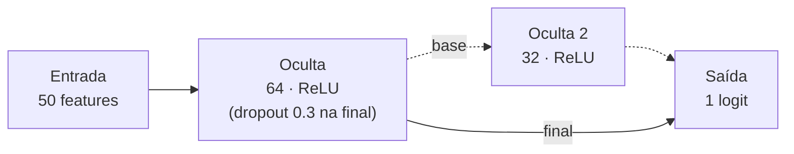
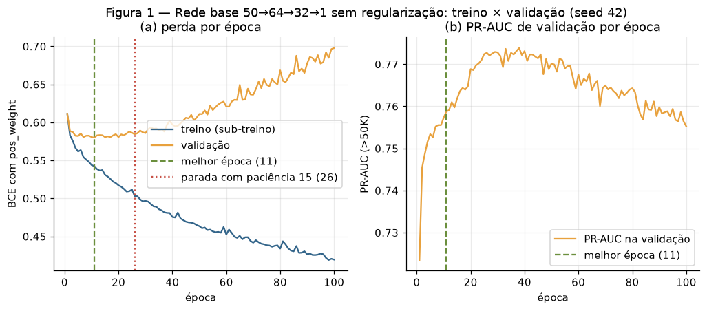
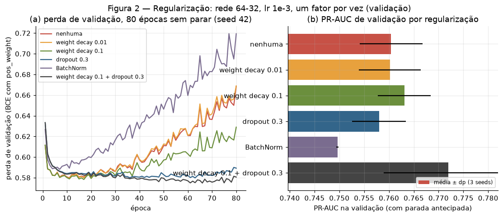
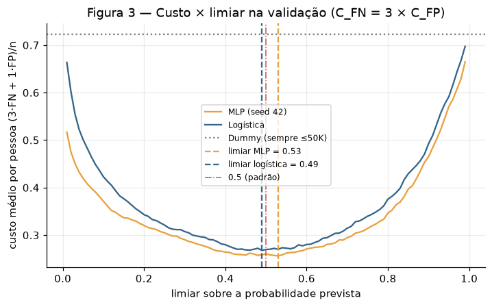
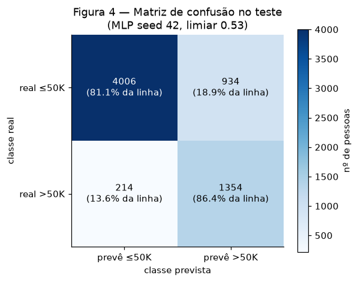
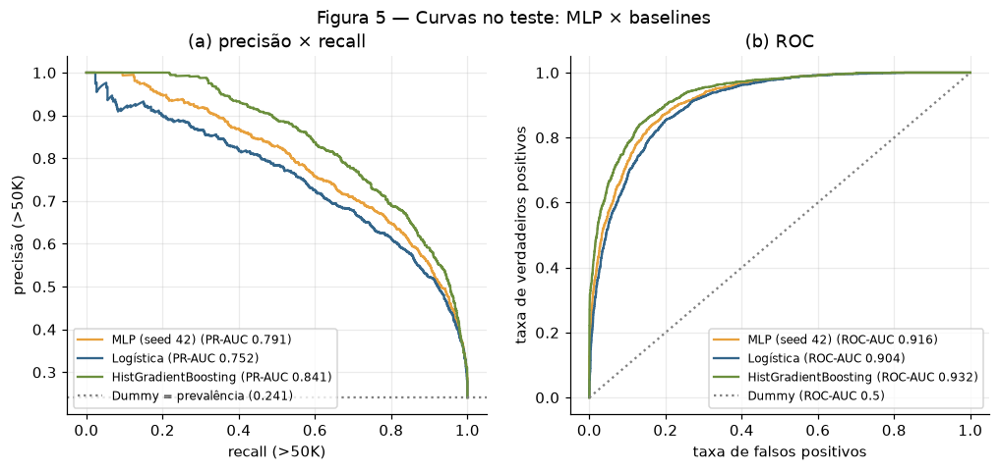
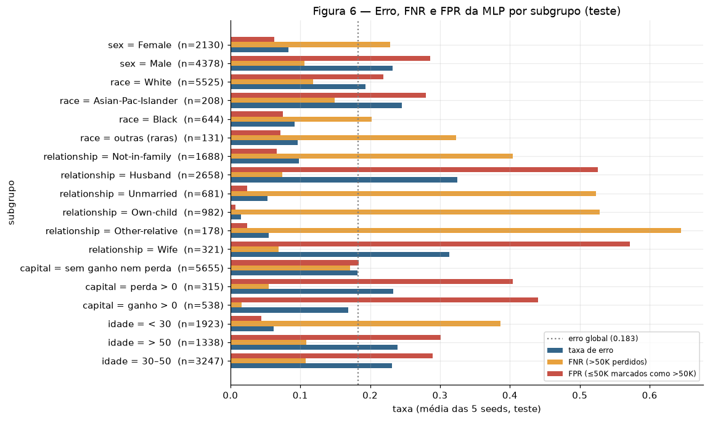
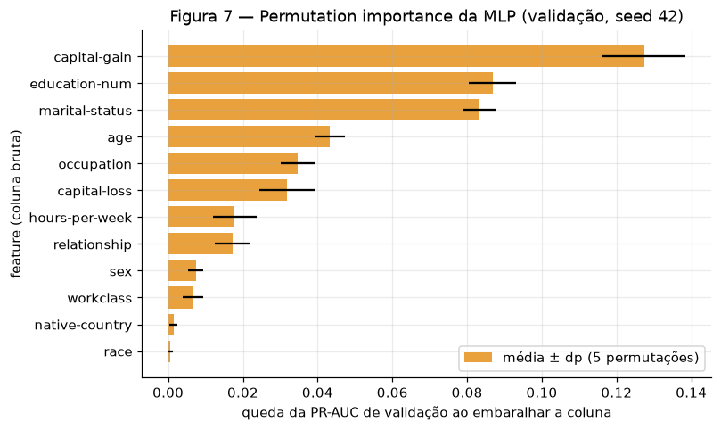

# 2. Classificação — Adult Income

!!! abstract "Entrega 2 do [Projeto](../index.md)"

    [Enunciado: Projects → Classification or Regression](https://insper.github.io/ann-dl/2026.2/projects/supervised/){:target='_blank'}
    · Classificação binária · mesmo dataset, tarefa, split e seed do [EDA](../eda/index.md)

!!! info "Equipe"

    | Nome completo | GitHub |
    |---------------|--------|
    | Gustavo Doniani Lagôa Gomes | [@LagoaGustavo](https://github.com/LagoaGustavo) (antes [@Lagoass](https://github.com/Lagoass)) |
    | Deena El Orra | [@DeenaElOrra](https://github.com/DeenaElOrra) |

    Dataset, decisões e status: [página do projeto](../index.md). O passo a passo do nosso
    raciocínio está em [Raciocínio — Classificação](../../raciocinio/classificacao.md).

!!! warning "Repositório e data de entrega"

    Perdemos o acesso à conta `@Lagoass`. Este repositório é um **fork** de
    [`Lagoass/ann-dl`](https://github.com/Lagoass/ann-dl){:target='_blank'} com o mesmo
    histórico, e o EDA continua com o commit original de 08/out. A entrega foi feita em
    **17/nov**, com autorização do professor (o prazo do enunciado era 13/nov).

!!! note "Uso de IA"

    Usamos Claude (Claude Code) como par de programação no código, nas figuras e na redação,
    seguindo as etapas do enunciado. Revisamos e sabemos explicar cada número e cada decisão.
    A mesma declaração está no front matter (`ai_use`).

!!! note "Reprodução"

    Todo número desta página sai dos scripts em
    [`code/`](https://github.com/LagoaGustavo/ann-dl/tree/main/docs/projects/classification/code){:target='_blank'}.
    A saída completa da última execução fica em
    [`code/saida.txt`](https://github.com/LagoaGustavo/ann-dl/blob/main/docs/projects/classification/code/saida.txt){:target='_blank'}.
    Os scripts importam o `pipeline.py` do EDA sem copiá-lo e usam seeds fixas, então
    rodar de novo dá os mesmos números. A execução completa leva cerca de 6 minutos numa CPU.

    ``` shell
    pip install -r requirements.txt
    pip install -r docs/projects/classification/code/requirements.txt --extra-index-url https://download.pytorch.org/whl/cpu
    python docs/projects/classification/code/roda_tudo.py   # roda s0 → s56 e grava saida.txt
    ```

    | Script | Passo | Gera |
    |---|---|---|
    | `comum.py` | 0 | módulo importável: split do EDA + validação, métrica, critério, custos, métricas |
    | `modelo.py` · `treino.py` | 2 · 3 | a MLP (PyTorch) e o loop com parada antecipada |
    | `s0_partida.py` | 0 | tamanhos, `pos_weight`, prova de ajuste só no sub-treino |
    | `s1_baselines.py` | 1 | baselines na validação |
    | `s23_rede_treino.py` | 2 · 3 | arquitetura, varredura de lr, Figura 1 |
    | `s4_regularizacao.py` | 4 | regularização, busca, Figura 2, `busca_resultados.csv` |
    | `s56_teste_erros.py` | 5 · 6 | teste único, subgrupos, permutação, ablações, Figuras 3–7 |

## 0. Starting point

**Pipeline do EDA importado, não copiado.** O módulo `code/comum.py` põe a pasta
`docs/projects/eda/code/` no `sys.path` e importa `load_clean`, `split` e
`build_preprocessor` do `pipeline.py` do EDA. Tudo vem igual ao EDA:

- o mesmo arquivo `adult.data`;
- a mesma limpeza: remove as 24 duplicatas, `education` e `fnlwgt`;
- o mesmo split treino/teste, 80/20 estratificado com `random_state=42` (26029 / 6508 linhas);
- o mesmo pré-processamento: `Unknown` para faltantes, `log1p` em capital, padronização e
  one-hot com balde `infrequent`.

**Validação tirada de dentro do treino.** O EDA não tinha validação. Separamos 20% do
treino do EDA, estratificado e com a mesma seed. O teste do EDA não é tocado.

| Conjunto | Linhas | `>50K` |
|---|---|---|
| sub-treino | **20823** | 5017 (24.09%) |
| validação | **5206** | 1254 (24.09%) |
| teste (o do EDA) | **6508** | 1568 (24.09%) |

**Sem vazamento.**

- O `ColumnTransformer` é ajustado **só no sub-treino** (`fit_transform`). A validação e o
  teste passam apenas por `transform`.
- A prova é a média das 5 numéricas padronizadas. Ela dá exatamente 0 no sub-treino e
  [0.0067, 0.0239, −0.0018, 0.0037, 0.0111] na validação. Se a validação tivesse entrado no
  ajuste, essa média também seria 0.
- O resultado tem **50 colunas** e **0 NaN**, a mesma estrutura do EDA.
- O corte de 1% do `min_frequency` agora é calculado em 20823 linhas, e mesmo assim
  nenhuma categoria mudou de balde.
- O teste só é carregado com `prepara(teste=True)`, chamado apenas pelo script do passo 5.

**Correções do EDA aplicadas aqui.** Mexer na pasta do EDA mudaria a data dela, então as
correções ficam nesta entrega:

1. No item 4C do EDA, `occupation` aparece com 15 colunas. São **14**, e a soma dos blocos
   one-hot dá 45 + 5 numéricas = 50 (a lista completa sai em `s0_partida.py`).
2. As decisões de descarte e o diagnóstico de vazamento de `capital-gain` foram medidos no
   dataset inteiro. Aqui, todas as decisões (validação, limiar, configuração) usam só o
   sub-treino e a validação.
3. A promessa do EDA, "treinar com e sem `capital-gain`", é cumprida na
   [seção 6](#6-error-analysis).

**Decidido antes de treinar.** Estes três pontos estão em `comum.py`, no commit
`0b77e07`, que é anterior a qualquer treino da rede.

- **Métrica principal: PR-AUC da classe `>50K`** (*average precision*).
    - Só 24.09% são positivos, e "sempre `≤50K`" já acerta 75.91%, então a acurácia não
      discrimina.
    - A PR-AUC não depende de limiar e tem como piso a prevalência (0.241).
    - É a métrica honesta para positivo minoritário.
- **Critério de sucesso.** A PR-AUC média da rede no **teste** precisa ser
  **≥ PR-AUC do melhor baseline obrigatório + 0.01**, e essa diferença precisa ser
  **maior que o desvio padrão** da rede entre seeds. O melhor baseline obrigatório é o
  trivial ou o linear, escolhido pela validação.
- **Custo dos erros (para o limiar).** O cenário é uma triagem de público de alta renda
  para uma oferta financeira.
    - Um **FN** (pessoa `>50K` não abordada) é uma venda perdida.
    - Um **FP** (pessoa `≤50K` abordada) é um contato desperdiçado, mais barato.
    - Fixamos **C_FN = 3 × C_FP**.
    - Com probabilidades calibradas, o limiar ótimo seria C_FP/(C_FP + C_FN) = 0.25.
    - Mas a perda com `pos_weight` distorce as probabilidades. Por isso o limiar é
      escolhido **varrendo 0.01…0.99 na validação** e pegando o de menor custo médio
      (3·FN + FP)/n. Esse procedimento não depende de calibração.

??? example "Código — `comum.py` (pipeline do EDA + validação + métrica, critério e custos)"

    ``` { .python .copy linenums="1" title="docs/projects/classification/code/comum.py" }
    --8<-- "docs/projects/classification/code/comum.py"
    ```

## 1. Baselines

Os três modelos usam a **mesma matriz de 50 colunas** do pipeline, ajustada no sub-treino.
O limiar de cada um é escolhido pelo custo na validação.

| Modelo (validação) | PR-AUC | ROC-AUC | limiar | acurácia | F1 macro | precisão >50K | recall >50K | F1 >50K | custo/pessoa |
|---|---|---|---|---|---|---|---|---|---|
| Dummy (`most_frequent`) | 0.2409 | 0.5000 | — | 0.7591 | 0.4315 | 0.0000 | 0.0000 | 0.0000 | 0.7226 |
| Logística (`class_weight="balanced"`) | **0.7283** | 0.8990 | 0.49 | 0.8022 | 0.7666 | 0.5583 | 0.8549 | 0.6755 | 0.2678 |
| HistGradientBoosting (opcional) | 0.8205 | 0.9259 | 0.47 | 0.8258 | 0.7923 | 0.5931 | 0.8812 | 0.7090 | 0.2315 |

**Leitura.**

- **O Dummy mostra por que a acurácia engana.** Ele acerta 75.91% sem aprender nada. A
  PR-AUC dele é exatamente a prevalência (0.2409) e a ROC-AUC é 0.5. Como nunca prevê
  `>50K`, paga 3 × 24.09% = 0.72 de custo por pessoa.
- **A logística é a barra de verdade.** O critério do passo 0 é relativo a ela, porque é o
  melhor baseline obrigatório na validação. O peso de classe `balanced` dá aos positivos
  um peso 3.15 vezes maior, o mesmo `pos_weight` da rede. Por isso o limiar de menor custo
  fica perto de 0.5 (0.49).
- **O HistGradientBoosting é a referência opcional.** Árvores em dado tabular costumam ser
  difíceis de bater, e ele já fica +0.09 de PR-AUC acima da logística. Ele não entra no
  critério, porque não é um modelo "mais simples", mas aparece em todas as comparações.

??? example "Código — `s1_baselines.py`"

    ``` { .python .copy linenums="1" title="docs/projects/classification/code/s1_baselines.py" }
    --8<-- "docs/projects/classification/code/s1_baselines.py"
    ```

## 2. The network

A rede base dos passos 2 e 3 é **50 → 64 → 32 → 1**. A rede final, escolhida no passo 4,
é **50 → 64 → 1**.



| | Escolha | Por quê |
|---|---|---|
| Camadas ocultas | base: 2 (64, 32); final: 1 (64) | O dado é tabular e pequeno: o PCA do EDA mostra 43 direções reais nas 50 colunas. Não há fronteira simples (a silhueta pela renda é ≤ 0.25 em PCA, t-SNE e UMAP), então vale ter não linearidade, mas não profundidade. A busca do passo 4 confirmou que **uma** camada de 64 basta. |
| Larguras | 64 → 32 (base) | Afunila das 50 entradas para poucas dezenas. Larguras de 128 e 3 camadas foram testadas no passo 4 e não melhoraram a validação. |
| Ativação | ReLU | A derivada é 1 para x > 0. A sigmoide tem derivada ≤ 0.25 e encolhe o gradiente camada a camada. |
| Inicialização | He (Kaiming normal) nas ocultas; Glorot na saída; vieses = 0 | He mantém a variância das ativações quando a ReLU zera metade delas. A saída é linear, então usa Glorot. |
| Saída | **1 unidade, sem sigmoide (logit)** | Classificação binária. A probabilidade σ(u) só é calculada na hora de prever. |
| Perda | `BCEWithLogitsLoss(pos_weight = 15806/5017 = 3.15)` | Junta sigmoide e entropia cruzada com o truque log-sum-exp, que é numericamente estável. O gradiente na saída é o mesmo σ(u) − y que deduzimos no [exercício MLP](../../exercises/mlp/index.md), com os positivos pesando 3.15× para compensar o desbalanceamento. O peso é calculado no sub-treino. |

**Parâmetros contra linhas de treino.**

| Rede | Parâmetros | Linhas de treino | Parâmetros por linha |
|---|---|---|---|
| base 50 → 64 → 32 → 1 | 3264 + 2080 + 33 = **5377** | 20823 | 0.258 |
| final 50 → 64 → 1 | 3264 + 65 = **3329** | 20823 | 0.160 |

As duas redes têm bem menos parâmetros que linhas. Mesmo assim, a rede base decora o
sub-treino se for treinada por tempo demais (passo 3): a capacidade não é só a contagem de
parâmetros.

??? example "Código — `modelo.py`"

    ``` { .python .copy linenums="1" title="docs/projects/classification/code/modelo.py" }
    --8<-- "docs/projects/classification/code/modelo.py"
    ```

## 3. Training

| | Escolha | Por quê |
|---|---|---|
| Otimizador | **AdamW**, com weight decay só nas matrizes de pesos | A página *Optimization* recomenda Adam como padrão para MLP tabular. AdamW é a mesma atualização com o decaimento desacoplado, que a página *Regularization* recomenda no lugar de Adam + L2. Com `weight_decay = 0` ele é exatamente o Adam, o que deixa o passo 4 comparar "sem regularização" de forma limpa. Vieses e BatchNorm ficam fora do decaimento. |
| Learning rate | 1e-3 na rede base; 3e-3 na final | A varredura abaixo deu a menor perda de validação em 1e-3. No passo 4, 3e-3 foi melhor quando combinado com dropout. |
| Batch | 256 | Dá 82 passos por época em 20823 linhas, dentro da faixa 32–512. Cada época leva **0.04 s** na CPU, então nada nos obriga a usar batches maiores. |
| Épocas | teto de 200, **parada antecipada com paciência 15** | Pela perda de validação, restaurando os melhores pesos (`copy.deepcopy` do `state_dict`), como no esqueleto do enunciado. O teto nunca é atingido. |

**Varredura de learning rate** (rede base, sem regularização, seed 42):

| lr | épocas rodadas | melhor época | perda de validação | PR-AUC de validação |
|---|---|---|---|---|
| 1e-1 | 20 | 5 | 0.5890 | 0.7528 |
| 1e-2 | 19 | 4 | 0.5820 | 0.7651 |
| **1e-3** | 26 | 11 | **0.5799** | 0.7588 |
| 1e-4 | 78 | 63 | 0.5809 | 0.7542 |

Nenhum valor diverge. O 1e-1 já fica claramente pior na perda e o 1e-4 leva 6 vezes mais
épocas para chegar ao mesmo ponto, então ficamos com 1e-3.


/// caption
**Figura 1** — Rede base 50→64→32→1 sem regularização, treinada 100 épocas **sem parar**
para mostrar onde o overfitting começa (seed 42). (a) perda por época; (b) PR-AUC de
validação por época.
///

**Leitura da Figura 1.**

- **Converge, e rápido.** A perda de validação cai de 0.6113 (época 1) para **0.5799 na
  época 11**, que é a melhor. A parada com paciência 15 interrompe o treino na **época 26**
  e restaura a época 11, com PR-AUC de validação 0.7588. A Figura 1 é a mesma corrida que a
  rede com parada antecipada faria, e o `s23_rede_treino.py` confirma: ela roda 26 épocas e
  restaura a 11.
- **O overfitting começa por volta da época 11.** Daí em diante a perda de treino continua
  caindo (0.5424 → 0.4195 na época 100), mas a de validação sobe (0.5799 → 0.6977). O gap
  validação − treino cresce de +0.0375 para **+0.2782**: a rede decora o sub-treino.
- **A perda e a PR-AUC discordam sobre *quando* parar.** A PR-AUC de validação ainda sobe
  até **0.7727 na época 26** e só cai depois da época 50 (0.7553 na 100).
    - A perda (log-loss) pune a **confiança excessiva** assim que as probabilidades começam
      a ficar extremas.
    - A PR-AUC só olha a **ordenação** das pessoas, que ainda melhora por algumas épocas.
    - Parar pela perda é, portanto, conservador nesta rede.
    - O passo 4 mostra que, com regularização, o problema praticamente some: a melhor
      época vai para ~40–60, e perda e PR-AUC passam a concordar.

??? example "Código — `treino.py` (loop com parada antecipada) e `s23_rede_treino.py`"

    ``` { .python .copy linenums="1" title="docs/projects/classification/code/treino.py" }
    --8<-- "docs/projects/classification/code/treino.py"
    ```

    ``` { .python .copy linenums="1" title="docs/projects/classification/code/s23_rede_treino.py" }
    --8<-- "docs/projects/classification/code/s23_rede_treino.py"
    ```

## 4. Regularization and hyperparameters

**A) Um fator por vez.** A rede é a base (64, 32) com lr 1e-3, e cada variante foi rodada
com 3 seeds (42, 43, 44). Todas usam a mesma parada antecipada. Como a parada também
regulariza, "nenhuma" aqui significa "só parada antecipada".

| Regularização (validação) | PR-AUC média ± dp | perda val | gap val − treino | melhor época (média) |
|---|---|---|---|---|
| nenhuma | 0.7604 ± 0.0063 | 0.5794 | +0.0429 | 14.7 |
| weight decay 0.01 | 0.7602 ± 0.0062 | 0.5792 | +0.0422 | 14.7 |
| weight decay 0.1 | 0.7631 ± 0.0053 | 0.5777 | +0.0472 | 19.7 |
| dropout 0.3 | 0.7580 ± 0.0054 | 0.5813 | +0.0343 | 27.3 |
| BatchNorm | 0.7496 ± 0.0002 | 0.5866 | +0.0402 | 7.3 |
| **weight decay 0.1 + dropout 0.3** | **0.7720 ± 0.0130** | **0.5760** | +0.0585 | 60.3 |


/// caption
**Figura 2** — (a) Perda de validação por época, 80 épocas **sem parar** (seed 42): sem
regularização (vermelho), a perda sobe a partir da época ~25 e chega a ~0.67. Com dropout,
e com dropout + weight decay, ela fica plana em ~0.58. (b) PR-AUC de validação de cada variante, com parada
antecipada (média ± dp de 3 seeds).
///

**Leitura.**

- **Weight decay sozinho mal faz efeito.** Com 0.01, a curva é idêntica à da rede sem
  regularização. Com 0.1, ganha +0.003, dentro do desvio. Com lr 1e-3, o decaimento
  desacoplado encolhe os pesos menos de 1% por época, e a parada acontece antes de isso
  pesar.
- **Dropout 0.3 sozinho é a técnica que mais segura o overfitting** (Figura 2a). O gap
  cai de +0.043 para +0.034 e a perda de validação não sobe em 80 épocas. Mas, na rede de
  duas camadas, ele não melhora a PR-AUC (0.7580).
- **BatchNorm piora.** A PR-AUC cai para 0.7496, a melhor época é a 7 e a perda de
  validação explode depois (Figura 2a, lilás). Hipótese: o BatchNorm acelera o ajuste ao
  sub-treino sem regularizar o suficiente com batches de 256, e a parada pela perda o
  interrompe cedo demais.
- **Combinar weight decay e dropout dá o melhor resultado da parte A** (0.7720, +0.012
  sobre "nenhuma"). A rede treina por mais tempo (época 60) sem degradar a validação.

**B) Busca.** A grade foi largura/profundidade {64 · 64-32 · 128-64 · 128-64-32} × lr
{1e-3 · 3e-3} × regularização {wd 0.1 · dropout 0.3 · wd 0.1 + dropout 0.3}. Três dessas
combinações já estavam na parte A, então são **27 configurações únicas** no total, cada uma
com 3 seeds, todas avaliadas **na validação**. As 10 melhores, ordenadas pela PR-AUC média
(a tabela completa está em `code/busca_resultados.csv` e em `saida.txt`):

| # | Configuração | Parâmetros | PR-AUC val (média ± dp) | perda val | melhor época |
|---|---|---|---|---|---|
| **1** | **64 · lr 3e-3 · dropout 0.3** | **3329** | **0.7773 ± 0.0039** | 0.5704 | 47.7 |
| 2 | 64-32 · lr 3e-3 · wd 0.1 + dropout 0.3 | 5377 | 0.7762 ± 0.0012 | 0.5752 | 32.0 |
| 3 | 64 · lr 3e-3 · wd 0.1 + dropout 0.3 | 3329 | 0.7727 ± 0.0023 | 0.5705 | 54.7 |
| 4 | 64-32 · lr 1e-3 · wd 0.1 + dropout 0.3 | 5377 | 0.7720 ± 0.0130 | 0.5760 | 60.3 |
| 5 | 64 · lr 1e-3 · dropout 0.3 | 3329 | 0.7718 ± 0.0100 | 0.5714 | 92.3 |
| 6 | 64 · lr 1e-3 · wd 0.1 + dropout 0.3 | 3329 | 0.7702 ± 0.0096 | 0.5711 | 119.7 |
| 7 | 64-32 · lr 3e-3 · dropout 0.3 | 5377 | 0.7695 ± 0.0171 | 0.5774 | 19.3 |
| 8 | 64-32 · lr 3e-3 · wd 0.1 | 5377 | 0.7691 ± 0.0078 | 0.5754 | 11.0 |
| 9 | 128-64-32 · lr 3e-3 · wd 0.1 | 16897 | 0.7683 ± 0.0079 | 0.5786 | 6.0 |
| 10 | 128-64-32 · lr 1e-3 · wd 0.1 + dropout 0.3 | 16897 | 0.7641 ± 0.0055 | 0.5777 | 27.7 |
| … | (17 outras, até BatchNorm com 0.7496) | | | | |

**Escolha e leitura.**

- **Escolhemos a configuração 1: uma camada de 64 ReLU, lr 3e-3, dropout 0.3, sem weight
  decay.** Ela tem a maior PR-AUC média e a menor perda de validação. Só a configuração 2
  fica a menos de 1 desvio dela, e a regra de desempate (rede menor) também aponta para a
  1, com 3329 contra 5377 parâmetros.
- **Mais rede não ajudou.** As redes de 128-64 e 128-64-32 (≈15–17 mil parâmetros)
  ficaram todas abaixo de 0.769. Elas atingem o mínimo da validação cedo (em 8 das 12
  configurações, antes da época 15) e depois só decoram.
- **Viés de seleção.** O melhor de 27 é otimista, e a PR-AUC de validação da escolhida
  (0.7773) deve ser lida assim. É por isso que o número que vale é o do teste, medido uma
  única vez no passo 5.
- **A configuração foi congelada em `comum.py` (`CONFIG_ESCOLHIDA`) no commit `f89dce2`,
  antes de existir o script do teste** (commit `1d4da6b`).

??? example "Código — `s4_regularizacao.py`"

    ``` { .python .copy linenums="1" title="docs/projects/classification/code/s4_regularizacao.py" }
    --8<-- "docs/projects/classification/code/s4_regularizacao.py"
    ```

## 5. Test evaluation

**Retreino.** A configuração congelada foi retreinada com **5 seeds** (42–46) no mesmo
sub-treino, cada uma com parada antecipada na mesma validação.

- As seeds 42–44 reproduzem exatamente as corridas da busca; 45 e 46 são novas.
- As redes rodaram 55, 71, 62, 58 e 48 épocas e restauraram as épocas 40, 56, 47, 43 e 33
  (média de 43.8).
- O limiar de cada seed foi escolhido **na validação**, pelo custo: 0.53, 0.52, 0.53, 0.55
  e 0.50.
- Os baselines foram ajustados no mesmo sub-treino, com limiar também escolhido na
  validação.
- Só então o teste foi avaliado, **uma vez**. Nenhuma escolha (configuração, limiar,
  época) usou o teste.


/// caption
**Figura 3** — Custo médio por pessoa (3·FN + FP)/n em função do limiar, na **validação**.
O mínimo da MLP (seed 42) fica em 0.53 e o da logística em 0.49. O Dummy paga 0.72.
///

**Por que o limiar fica em ~0.5 e não em 0.25.** Treinar com `pos_weight = 3.15` já
equivale a pesar o FN cerca de 3 vezes mais que o FP. As probabilidades que a rede devolve
saem "infladas" na mesma proporção, e o limiar 0.5 sobre elas corresponde a ~0.24 sobre a
probabilidade real. Como o custo que escolhemos (3:1) é quase igual ao `pos_weight`, a
varredura na validação cai perto de 0.5. A Figura 3 mostra que o custo é plano entre ~0.45
e 0.55, então a escolha exata pouco importa.

**Tabela única no teste (6508 linhas, 1568 `>50K`):**

| Modelo (teste) | PR-AUC | ROC-AUC | acurácia | F1 macro | precisão >50K | recall >50K | F1 >50K | custo/pessoa |
|---|---|---|---|---|---|---|---|---|
| Dummy (`most_frequent`) | 0.2409 | 0.5000 | 0.7591 | 0.4315 | 0.0000 | 0.0000 | 0.0000 | 0.7228 |
| Logística | 0.7517 | 0.9044 | 0.8019 | 0.7673 | 0.5574 | 0.8635 | 0.6775 | 0.2638 |
| **MLP (média ± dp, 5 seeds)** | **0.7964 ± 0.0031** | **0.9175 ± 0.0010** | 0.8171 ± 0.0073 | 0.7831 ± 0.0062 | 0.5802 ± 0.0128 | 0.8741 ± 0.0099 | 0.6973 ± 0.0062 | 0.2436 ± 0.0028 |
| HistGradientBoosting (opcional) | 0.8409 | 0.9324 | 0.8307 | 0.7979 | 0.6005 | 0.8878 | 0.7164 | 0.2234 |

**Métricas por classe da MLP** (média ± dp das 5 seeds):

- `≤50K`: precisão 0.9524 ± 0.0028, recall 0.7990 ± 0.0127, F1 0.8689 ± 0.0063.
- `>50K`: precisão 0.5802 ± 0.0128, recall 0.8741 ± 0.0099, F1 0.6973 ± 0.0062.

O `classification_report` da seed 42 (limiar 0.53) está em `saida.txt`. Ele dá precisão,
recall e F1 de 0.949 / 0.811 / 0.875 (`≤50K`) e 0.592 / 0.864 / 0.702 (`>50K`), com
acurácia 0.824.


/// caption
**Figura 4** — Matriz de confusão no teste (MLP seed 42, limiar 0.53). TN 4006 · FP 934 ·
FN 214 · TP 1354.
///

A matriz mostra o efeito do custo 3:1. A rede **perde só 13.6% dos `>50K`** (214 FN) e,
em troca, marca como `>50K` 18.9% dos `≤50K` (934 FP). Para o cenário de triagem, esse é o
lado certo do trade-off.


/// caption
**Figura 5** — Curvas no teste: (a) precisão × recall, com a linha do Dummy na prevalência
(0.241); (b) ROC. MLP seed 42 (PR-AUC 0.791), logística (0.752) e HistGradientBoosting
(0.841).
///

**Critério do passo 0: ATINGIDO.**

- A PR-AUC da MLP no teste é **0.7964 ± 0.0031**, contra 0.7517 da logística: diferença de
  **+0.0447**.
- O critério exigia ≥ +0.01, e a diferença é cerca de **14 vezes o desvio padrão entre
  seeds** (0.0031).
- A curva PR da rede fica acima da logística em praticamente todo o recall (Figura 5a). O
  custo por pessoa cai de 0.2638 para 0.2436 (−7.7%).
- **A diferença para a logística é muito maior que a variação entre seeds.** A pior seed
  (0.7914) ainda fica +0.040 acima da logística.

**Mas a rede não é o melhor modelo.** O HistGradientBoosting, sem nenhuma busca de
hiperparâmetros, chega a **0.8409**. Isso é **0.0445 acima da MLP**, praticamente a mesma
distância que separa a MLP da logística. É o resultado comum em dado tabular que o
enunciado antecipa, e o registramos como resultado, não como falha do critério. O
critério compara com os baselines obrigatórios, e foi escrito antes de treinar.

??? example "Código — `s56_teste_erros.py` (passos 5 e 6)"

    ``` { .python .copy linenums="1" title="docs/projects/classification/code/s56_teste_erros.py" }
    --8<-- "docs/projects/classification/code/s56_teste_erros.py"
    ```

## 6. Error analysis

**Erro por subgrupo.** O erro de cada subgrupo do teste é a média das 5 seeds, cada uma no
seu limiar. Os subgrupos são as categorias que o EDA destacou. Nesta tabela:

- FNR é a fração de `>50K` perdidos;
- FPR é a fração de `≤50K` marcados como `>50K`;
- o erro global é **0.1829**.

| Subgrupo | n | % >50K | erro | FNR | FPR |
|---|---|---|---|---|---|
| **relationship = Husband** | **2658** | 44.5% | **0.3251** | 0.0746 | **0.5256** |
| marital-status = Married-civ-spouse | 3029 | 44.7% | 0.3208 | 0.0757 | 0.5187 |
| relationship = Wife | 321 | 51.4% | 0.3134 | 0.0691 | 0.5718 |
| workclass = Self-emp-inc | 215 | 57.7% | 0.2651 | 0.0403 | 0.5714 |
| race = Asian-Pac-Islander | 208 | 26.4% | 0.2452 | 0.1491 | 0.2797 |
| sex = Male | 4378 | 30.0% | 0.2317 | 0.1061 | 0.2856 |
| sex = Female | 2130 | 11.9% | 0.0826 | **0.2283** | 0.0629 |
| race = White | 5525 | 25.6% | 0.1932 | 0.1185 | 0.2189 |
| race = Black | 644 | 13.5% | 0.0919 | 0.2023 | 0.0747 |
| idade < 30 | 1923 | 5.3% | 0.0621 | **0.3861** | 0.0441 |
| capital: ganho > 0 | 538 | 63.9% | 0.1688 | 0.0157 | 0.4402 |
| capital: perda > 0 | 315 | 48.9% | 0.2330 | 0.0545 | 0.4037 |
| capital: sem ganho nem perda | 5655 | 18.9% | 0.1815 | 0.1716 | 0.1838 |
| capital-gain = 99999 (teto) | 35 | 100% | 0.0000 | 0.0000 | — |
| native-country = Mexico | 130 | 1.5% | 0.0246 | 0.5000 | 0.0172 |


/// caption
**Figura 6** — Taxa de erro, FNR e FPR da MLP por subgrupo no teste (média das 5 seeds; n
no rótulo). A linha pontilhada é o erro global (0.183).
///

**Padrões e hipóteses.**

1. **O maior erro está nos casados: Husband (32.5%), Married-civ-spouse (32.1%) e Wife
   (31.3%).** Quase todo esse erro é FP (FPR de 52–57%).
    - *Hipótese:* "casado" é o sinal mais forte para `>50K` (44.7% contra 4.7% dos solteiros
      no EDA). Com o custo 3:1, a rede prefere marcar como `>50K` quase todo casado com
      perfil médio. Nos casados a prevalência é ~45%, próxima da indecisão, então o erro
      se concentra ali.
    - O mesmo vale para Self-emp-inc (57.7% de `>50K`).
    - A taxa de erro alta é consequência da prevalência intermediária, não de um defeito
      da rede nesse grupo.
2. **Mulheres, pessoas negras, jovens e quem não tem capital: o erro é baixo, mas é FN.**
    - FNR das mulheres é 22.8%, contra 10.6% dos homens; das pessoas negras, 20.2%,
      contra 11.9% das brancas; dos menores de 30, 38.6%.
    - *Hipótese:* a rede aprendeu as taxas-base do censo de 1994 (`>50K` é 11.9% entre as
      mulheres e 30.0% entre os homens). Quem é `>50K` sendo de um grupo de taxa-base
      baixa fica com probabilidade baixa e é perdido.
    - É um viés herdado dos dados, e o passo 7 discute quem ele afeta.
3. **Capital:** quem tem ganho de capital quase nunca é perdido (FNR 1.6%), e o teto
   99999 tem erro zero (35 pessoas), como o EDA previa. Mas o FPR é de 44%: a rede trata
   qualquer ganho de capital como sinal forte de `>50K`. Sem ganho nem perda, que é o
   grupo difícil (n = 5655), o erro é 18.2%.

**Piores exemplos** (MLP seed 42; colunas brutas completas em `saida.txt`):

- **5 FP mais confiantes, com p de 0.977 a 0.988.** São todos homens brancos casados
  (`Husband`), de 45–52 anos, com 12–16 anos de estudo, trabalhando 40–55 h, e **todos** com
  `capital-gain` = 5013 ou `capital-loss` de 1740–2002. São o perfil típico `>50K`.
  *Hipótese:* rendas logo abaixo do corte de 50K, ou ruído de rótulo, já que a renda é
  autodeclarada. Nenhuma feature distingue 48K de 52K.
- **5 FN mais confiantes, com p de 0.002 a 0.009.** São jovens solteiros (24–26 anos), uma
  viúva de 61 anos, um homem de 77 anos com 4 anos de estudo trabalhando 20 h, e uma
  divorciada que trabalha 20 h. Ninguém tem capital. *Hipótese:* a renda vem de fontes que
  o dataset não tem (aposentadoria, patrimônio, família). O perfil observável é de `≤50K`.

**Permutation importance.** Embaralhamos cada uma das 12 colunas **brutas** na validação,
passamos de novo pelo pipeline e medimos a queda da PR-AUC. Usamos a seed 42, com 5
repetições por coluna. Embaralhar a coluna bruta, e não cada one-hot, mantém a codificação
válida.


/// caption
**Figura 7** — Queda da PR-AUC de validação (base 0.7732) ao embaralhar cada coluna
(média ± dp de 5 permutações).
///

| Ordem | Rede (queda de PR-AUC) | EDA (amplitude da taxa de `>50K` + PC1) |
|---|---|---|
| 1 | capital-gain (0.1273) | relationship |
| 2 | education-num (0.0868) | marital-status |
| 3 | marital-status (0.0832) | capital-gain |
| 4 | age (0.0433) | education-num |
| 5 | occupation (0.0347) | age |
| 6 | capital-loss (0.0319) | occupation |
| 7 | hours-per-week (0.0178) | hours-per-week |
| 8 | relationship (0.0173) | sex |
| 9 | sex (0.0074) | workclass |
| 10 | workclass (0.0067) | capital-loss |
| 11 | native-country (0.0014) | race |
| 12 | race (0.0006) | native-country |

**Confere com o EDA?** Em boa parte, sim: a correlação de Spearman entre os dois rankings é
**0.720**.

- O núcleo é o mesmo: capital-gain, education-num, marital-status, age e occupation estão
  entre os 6 primeiros nos dois.
- race e native-country estão no fim nos dois.
- **A grande diferença é `relationship`**: 1º no EDA, 8º na rede.
    - *Hipótese:* `relationship` é quase redundante com `marital-status` + `sex` (`Husband`
      = casado + homem; `Wife` = casada + mulher; já marcado como redundância parcial no
      EDA).
    - Ao embaralhar só `relationship`, a rede recupera a informação pelas outras duas.
    - A permutation importance subestima features correlacionadas: ela mede o que se perde
      **sozinho**, e não o quanto a feature se relaciona com o alvo.
- `capital-loss` sobe do 10º para o 6º lugar. O EDA já mostrava que perda > 0 dá 50.9% de
  `>50K`, o dobro da média.

**Ablações prometidas no EDA** (validação, configuração escolhida, 3 seeds):

| Features | Colunas | MLP PR-AUC val | Logística |
|---|---|---|---|
| todas | 50 | 0.7773 ± 0.0039 | 0.7283 |
| sem `capital-gain` e `capital-loss` | 48 | **0.7115 ± 0.0011** | 0.6860 |
| sem `sex`, `race` e `relationship` | 38 | 0.7803 ± 0.0033 | 0.7227 |

- **Sem capital, a PR-AUC cai 0.066.** É a feature mais importante, como a permutação
  mostrou.
- No teste, no subconjunto **sem ganho nem perda de capital** (n = 5655, 18.9% de `>50K`),
  a MLP tem PR-AUC **0.6708 ± 0.0026** contra 0.6352 da logística. A vantagem da rede
  (+0.036) **continua sem o sinal quase mecânico** de capital. Ela não vem só do atalho
  que o EDA marcou como risco.
- **Tirar os três atributos sensíveis não custa nada** (0.7803, dentro de 1 dp de 0.7773):
  o que eles carregam já está em `marital-status`, `occupation` e `hours-per-week`.

## 7. Conclusion

**A rede valeu a pena?** Contra os modelos mais simples, sim.

- Ela supera a logística por **+0.045 de PR-AUC** no teste, cerca de 14 vezes a variação
  entre seeds.
- Também reduz o custo por pessoa em 7.7% e mantém a vantagem mesmo sem as colunas de
  capital. Ou seja, aprende interações que o modelo linear não aprende.
- Ela **não** é o melhor modelo para este problema. O HistGradientBoosting, sem tuning,
  fica 0.0445 acima.
- Se o objetivo fosse colocar um modelo em produção, usaríamos árvores. A MLP só se
  justificaria se precisasse fazer parte de um sistema maior treinado por gradiente.

**Limitações.**

- **Um único split.** Os ± são variação de seed, não de amostra. Com validação cruzada, a
  incerteza seria maior.
- **Probabilidades descalibradas.** O `pos_weight` infla as probabilidades, então "p =
  0.53" não significa 53% de chance. Para usar a probabilidade em si, seria preciso
  calibrar, com temperature scaling na validação, por exemplo.
- **Viés de seleção.** A configuração é a melhor de 27 na validação.
- **Parada pela perda.** É conservadora nesta rede (passo 3). Parar pela PR-AUC poderia
  render um pouco mais.
- **O custo 3:1 é uma suposição de cenário**, não um dado.
- **Dados antigos e truncados.** São do censo dos EUA de 1994, com valores no teto
  (`age` 90, `hours-per-week` 99, `capital-gain` 99999). O limite de 50K não foi corrigido
  pela inflação.

**Quem seria afetado por um erro.** Se este modelo decidisse acesso a crédito, a uma
oferta ou a um benefício, os erros **não se distribuem por igual**.

- **Um `>50K` é perdido** (FN) duas vezes mais entre as mulheres (FNR 22.8%) que entre os
  homens (10.6%). O mesmo acontece entre pessoas negras (20.2%) e brancas (11.9%), e em
  38.6% dos menores de 30.
- **Um `≤50K` é marcado como `>50K`** (FP) em 28.6% dos homens contra 6.3% das mulheres.
- Remover `sex`, `race` e `relationship` não custa desempenho. Mas isso **não** resolve:
  `marital-status`, `occupation` e `hours-per-week` carregam a mesma informação. Equidade
  exigiria medir e restringir FNR/FPR por grupo, não só esconder colunas.

**Com mais tempo:**

- validação cruzada no treino;
- calibração das probabilidades;
- parada antecipada pela PR-AUC;
- embeddings para as categóricas, em vez de one-hot;
- comparar com um boosting ajustado e com um ensemble das 5 seeds;
- avaliar restrições de equidade (taxas de erro iguais entre grupos).

## Results summary

| # | Resumo | Valor |
|---|---|---|
| 1 | Dataset, tarefa, alvo e métrica principal | Adult Income (UCI, censo dos EUA de 1994) · classificação binária · `income` (`>50K` vs `≤50K`) · **PR-AUC da classe `>50K`** |
| 2 | Linhas de treino · validação · teste | **20823 · 5206 · 6508** (o treino do EDA, 26029, dividido em 80/20 estratificado; teste do EDA intacto) |
| 3 | Melhor baseline e sua métrica no teste | **Regressão logística**, PR-AUC **0.7517** (melhor baseline obrigatório, escolhido na validação). Referência opcional: HistGradientBoosting, 0.8409 |
| 4 | Rede escolhida: camadas × unidades, nº de parâmetros, regularização | **1 camada oculta × 64 unidades ReLU** (50 → 64 → 1 logit), **3329 parâmetros**, **dropout 0.3** (+ parada antecipada) |
| 5 | Otimizador, taxa, batch e época de parada | **AdamW** (weight decay 0, equivale a Adam), **lr 3e-3**, **batch 256**; parou nas épocas 55/71/62/58/48 (média 58.8) e restaurou os pesos das épocas 40/56/47/43/33 (média 43.8) |
| 6 | Métrica principal da rede no teste (média ± dp) | PR-AUC **0.7964 ± 0.0031** (5 seeds; ROC-AUC 0.9175 ± 0.0010) |
| 7 | Critério de sucesso atingido? | **Sim**: +0.0447 sobre a logística (exigido ≥ +0.01 e > dp 0.0031) |
| 8 | Subgrupo com o maior erro e seu valor | **relationship = Husband**: erro **0.3251** (n = 2658; FPR 0.5256, FNR 0.0746), contra 0.1829 no geral |
